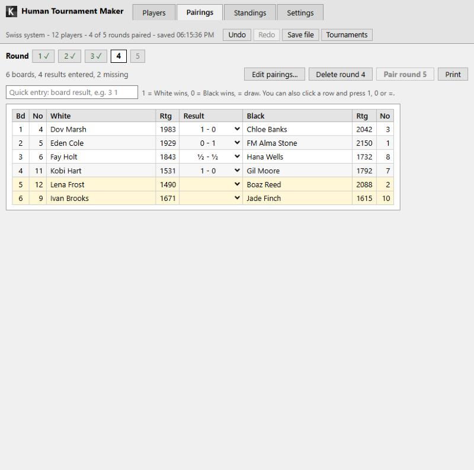
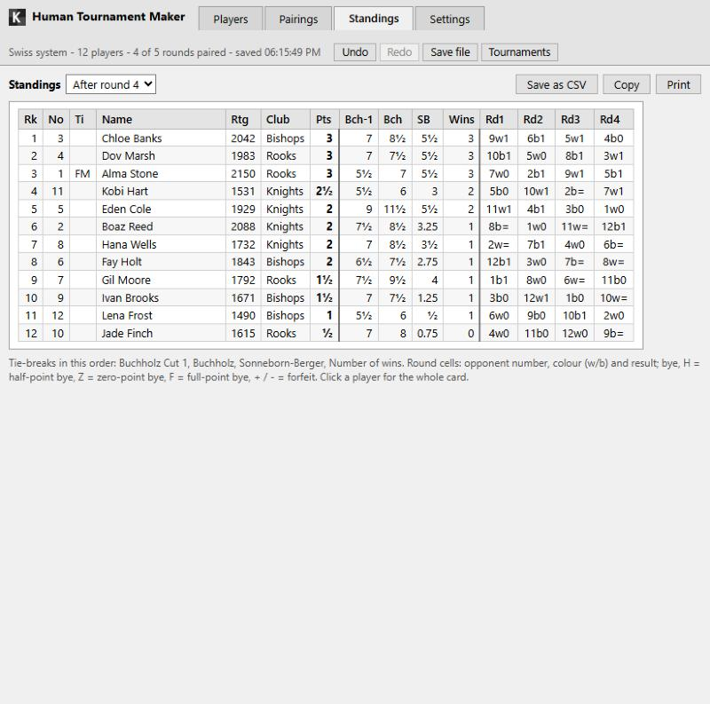
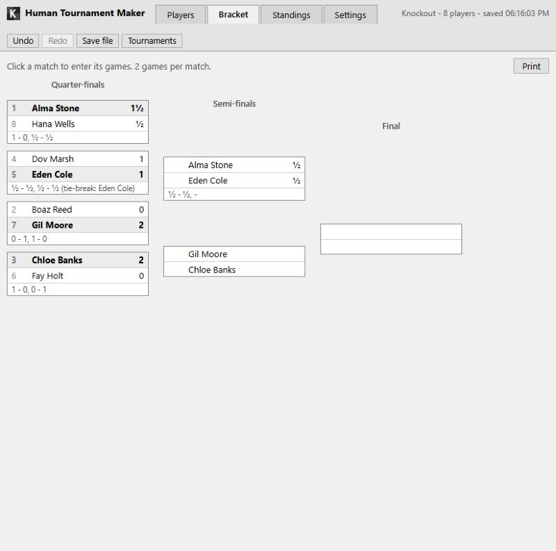

# Human Tournament Maker

A small program for running chess tournaments between people. Enter the players, let the program make the pairings of every round, type the results as they come in, and print the pairings and the standings. It has the plain, classic look of the usual tournament programs and works without a server, an account or an internet connection.



## Use it

Open `index.html` in a browser (Chrome, Edge, Firefox or Safari). That is all: there is nothing to install. The file `human-tournament-maker.html` is the same program in one single file, handy for copying to a USB stick or sending by mail; it is built from the sources with `python tools/build_single.py`.

**Your data.** Every change is saved in the browser at once, so closing the window loses nothing. Use **Save file** (top bar) to keep a copy as a file, and **Open file** or drag a file into the window to load one, for example on another computer. **Undo** and **Redo** (Ctrl+Z, Ctrl+Y) take back changes, including a deleted round. Browser data can be wiped by "clear browsing data", so save a file when the tournament is over.

## What it can do

* **Three formats.** *Swiss system* (Dutch pairings, any number of rounds), *round robin* (the FIDE Berger tables, single or double) and *knockout* (seeded single elimination with byes for the top seeds, matches of 1 to 5 games, a tie-break winner for tied matches).
* **Players.** Name, title, rating, federation and club; type them one by one, or paste a whole list, one player per line (`Dana Katz; 1850`, `GM Alex Smith 2510`, or columns copied from a spreadsheet). Names in any script work, Hebrew included. Sort by rating, reorder by hand, requested byes (half-point, zero-point or full-point) for chosen rounds, withdrawals, and late entries after round 1.
* **Pairings.** The next Swiss round is paired in one click; the pairings can be edited by hand (change players, swap colours, add a board or a bye). Players who have withdrawn or asked for a bye are left out; an odd number of players gets the bye for the lowest-ranked player who has not had one yet.
* **Results.** One select per board, or the keyboard: click a row and press `1` (White wins), `0` (Black wins) or `=` (draw) and the next row is ready; or type `3 1` in the quick-entry box to give board 3 to White. Forfeits (`+ : -`, `- : +`, `- : -`) are supported.
* **Standings.** Points and up to five tie-breaks in the order you choose: direct encounter, number of wins, wins with Black, games with Black, Buchholz (full, cut 1, cut 2, median, median 2), Sonneborn-Berger, progressive score, Koya, average rating of opponents, performance rating, rating. Unplayed games (byes, forfeits) count against a virtual opponent as in the FIDE Tie-Break Regulations. Standings can be shown after any round; a click on a player opens the player's card.
* **Cross table** for round robins, bracket view for knockouts, standings as CSV, copy to a spreadsheet, and printing (the browser's Print dialog; the page is laid out for paper).
* **Points** are adjustable (1 / ½ / 0 by default, or 3 / 1 / 0), as are the points of byes and forfeits.





## How the Swiss pairing works

The pairing follows the structure of the FIDE Dutch system (C.04.3):

* Players are grouped by score. Inside a score group the upper half is paired with the lower half (1 against n/2+1, 2 against n/2+2, and so on); when that is not possible the program tries the next arrangements in the order of the transpositions and exchanges.
* Nobody plays the same opponent twice. The pairing is only accepted if all the remaining players can still be paired (a matching check, so the program never paints itself into a corner), and the bye goes to the lowest-ranked player of the lowest score who has not had a bye or a forfeit win.
* Players who cannot be paired inside their group move down; as few as possible do, with the smallest score difference.
* Colours follow the colour preferences (absolute: the same colour twice in a row or a difference of two; strong: a difference of one; mild: alternate). Conflicts are minimised, then the repetition of floats from the previous rounds.
* Round 1: the top half against the bottom half, the colours alternating down the boards; the colour of the top seed is a setting.

It is **not** an FIDE-approved pairing program. It does not implement every detail and exchange order of the rules, accelerated pairings or the exemptions for top scorers in the last round, so in rare cases its pairing differs from the one an approved program gives. For a rated event, check the pairings with approved software. For a club tournament it makes valid, balanced pairings, and every pairing it makes passes the checks below.

## Tests

The tournament logic has no screen code and is tested from the command line with [Deno](https://deno.com):

```
deno run -A tests/test_engine.js
```

56 checks, among them: the Berger tables equal the FIDE tables for 6 and 8 players and have the right properties for 2 to 40; random Swiss tournaments (2 to 63 players with byes and withdrawals) never repeat a pairing, pair every player exactly once, and give the same colour three times in a row in fewer than 2 % of the games (it is well under 1 % in practice); on tiny fields the program finds a rematch-free pairing whenever one exists (brute-force comparison); 150 players over 9 rounds are paired in a few seconds; knockouts of 2 to 33 players; tie-break values (Buchholz, Sonneborn-Berger, virtual opponents for byes, direct encounter); files.

## Files

* `index.html`, `app.css`, `js/` - the program (`core.js` model and standings, `swiss.js` Swiss pairing, `rr.js` round robin and knockout, `io.js` files, `ui.js`, `dialogs.js`, `views.js`, `app.js` the screens)
* `human-tournament-maker.html` - the same in one file
* `tests/test_engine.js`, `tools/build_single.py`, `docs/` - tests, build script, pictures

Nothing is sent anywhere: the program is plain HTML and JavaScript with no libraries and no network access.
